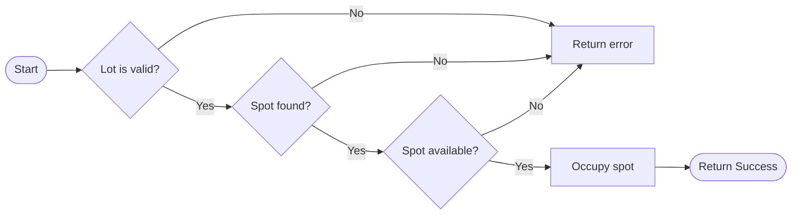
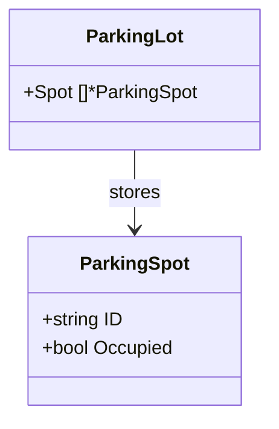
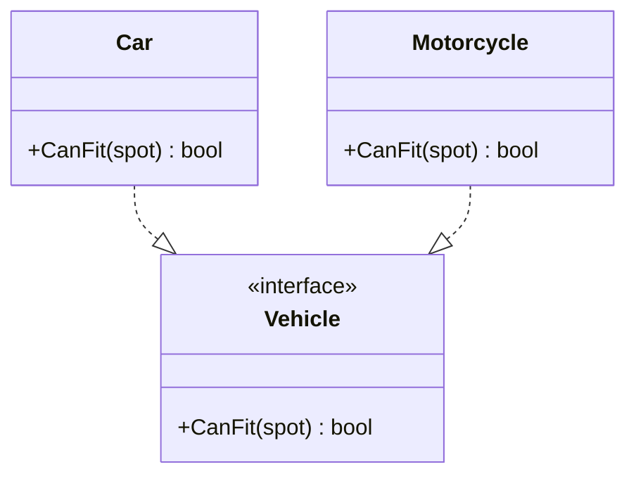
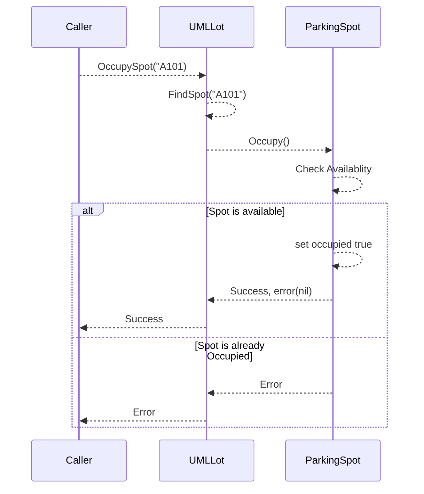
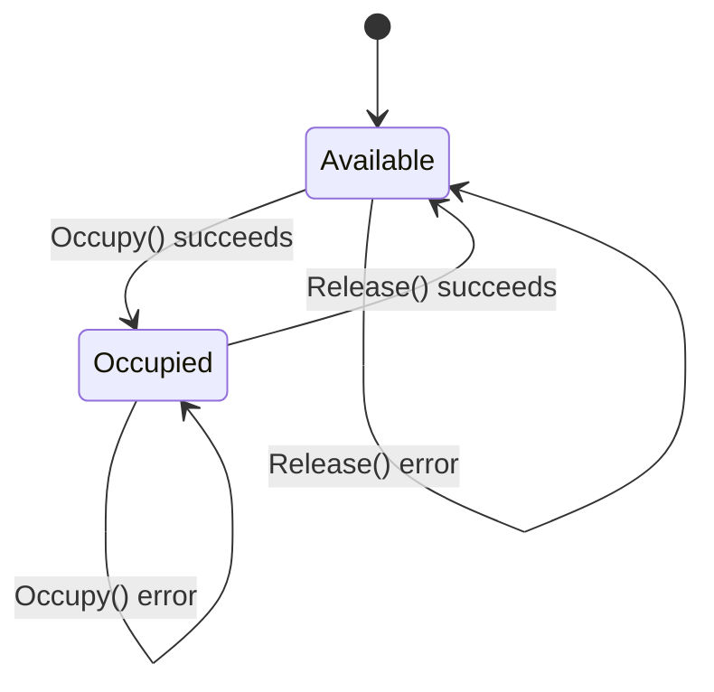

# Mermaid Diagrams

## Basic Syntax

TD - Top to bottom
LR - Left to right
BT - Bottom to top
RL - Right to left

## Node Shapes

Rectangle - A[ParkingLot] A process or ordinary step.
Rounded - A([Start]) Often used for a start or end point.
Decision - A{spot available?} A condition with multiple possible outcomes.
Start / End - A((Start)) A circular node.

## The arrows

A --> B Directional arrow
A --- B Line without an arrow
A -.-> B Dotted arrow
A ==> B Thick arrow
A --> success| B\| Arrow labelledsuccess

## Parking lot OccupySpot flowchart

Imagine the logic inside OccupySpot(id string):

1. Is the lot valid?
2. Can we find the spot?
3. Can we occupy it?
4. Return success or an error.

## Common Mermaid class relationship symbols

| Symbol | Meaning |
| --- | --- |
| A --> B | Navigable association |
| A ..> B | Dependency |
| A o-- B | Aggregation |
| A *-- B | Composition |
| A --\|> B | Inheritance/generalization |
| A ..\|> B | Interface realization |

## Tasks

create a Mermaid class diagram containing both types, their fields, and a relationship showing that one ParkingLot can refer to multiple ParkingSpot objects.

### Task1

Write a complete Mermaid class diagram containing:

- Vehicle as an interface with CanFit(spot) bool.
- Car and Motorcycle, each with a CanFit(spot) bool method.
- The correct implementation relationship from both structs to Vehicle.

### Task2

Draw a sequence diagram that shows:

1. The caller invokes OccupySpot("A101").
2. UMLLot looks up the spot.
3. If the spot exists, the lot calls ParkingSpot.Occupy().
4. The result returns to the caller.
5. If the spot doesn't exist, the caller receives an error.

### Task3

Model the lifecycle of a ParkingSpot.

Your states and transitions are:
Current state Event Result
Available Occupy() succeeds Occupied
Occupied Release() succeeds Available
Occupied Occupy() fails Remains Occupied
Available Release() fails Remains Available

