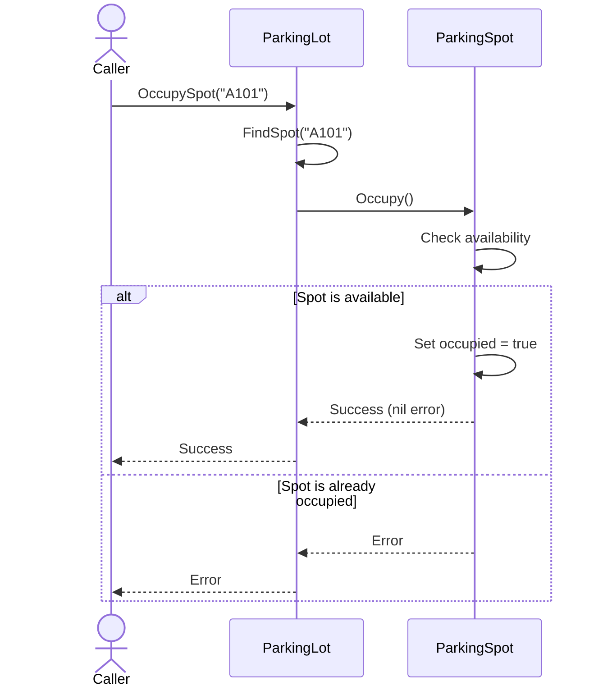

# UML Diagrams & Interaction Flows

Sequence diagrams illustrate how participants communicate over time. Read interactions from top to bottom.

## Participants and Lifelines

Participants are the objects, or systems involved in a scenario. Each participant is shown with a vertical lifeline, which represents its presence during the interaction.

## Messages

Horizontal arrows represent messages between participants, such as method calls, requests, and results. Solid arrows commonly show calls; dashed arrows commonly show return messages. Labels on arrows identify the operation or data being sent.

An activation bar on a lifeline indicates that a participant is performing an operation. A synchronous call waits for a response, while an asynchronous message lets the sender continue without waiting.

## Combined Fragments

Combined fragments group interactions to express control flow:

- **`alt`** — alternative paths, each with a guard condition (similar to `if` / `else`).
- **`opt`** — an optional path taken only when its guard condition is true.
- **`loop`** — a repeated interaction, often with a condition or iteration count.

## Example

```text
Client -> Service: request()
Service -> Repository: findById(id)
Repository --> Service: result
Service --> Client: response
```

Use sequence diagrams to clarify call order, participant responsibilities, and important branches in a workflow.


